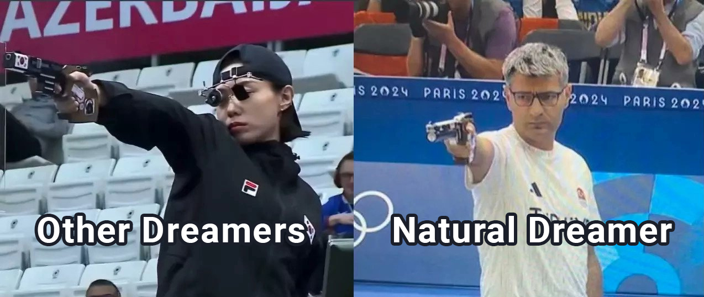
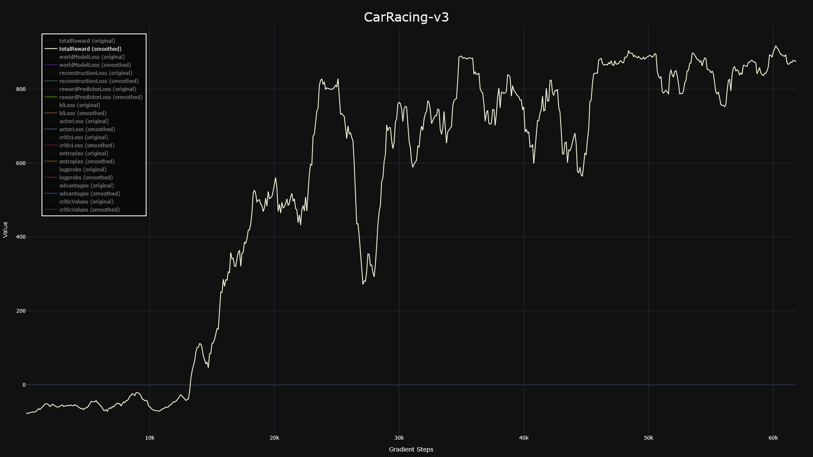

# Natural Dreamer is a natural.

This is a simple and clean implementation of [DreamerV3 paper](https://arxiv.org/pdf/2301.04104), that makes it maximally easy to study the architecture and understand the training pipeline.

With no fancy (complex) gear, Natural Dreamer is a natural, that's naturally beautiful.

<p align="center">

</p>

Want to learn how it works? I made a [tutorial](https://www.youtube.com/watch?v=viXppDhx4R0) with paper, diagrams and code from this repo.

🚧 Warning 🚧: The repo isn't in it's final form, it's still work in progress. Core algorithm works, but I should benchmark it on many types of environments, while right now, only CarRacing-v3 env (continuous actions, image observations) is solved.


## Performance

Only CarRacing-v3 is solved for now.

<p align="center">

</p>

The trace shows a moving average of 10 values. This plot is also nicely cropped, since after that point the performance started slowly declining from overtraining.

Environment steps are roughly 10x the gradient steps, so 60k gradient steps is around 600k environments steps. I mostly show gradient steps because I could greatly increase the replay ratio to minimize the environment steps. I could probably slightly increase the learning rate to learn faster as well, but oh well, I have no idea what axis to show.

## How to use it?

```bash
pip install -r requirements.txt
pip install -e dynamic-environments        # MuJoCo tasks, only needed for catching
export MUJOCO_GL=egl                       # headless MuJoCo rendering
python main.py --config configs/catching.yml
python main.py --config configs/car-racing-v3.yml
```

Any config value can be overridden from the command line, e.g. a 2-minute smoke test of the whole pipeline:

```bash
python main.py --config configs/catching.yml --set numEnvs=2 envSteps=2000 prefillSteps=400 logInterval=400 \
    evaluationInterval=1000 numEvaluationEpisodes=2 dreamer.batchSize=4 dreamer.batchLength=32 \
    dreamer.model.hiddenSize=64 dreamer.model.recurrentSize=256 dreamer.model.latentClasses=8 dreamer.model.cnnDepth=8
```

Outputs: `metrics/<run>.csv` (+ `_evaluation.csv`), `plots/<run>.html`, `checkpoints/<run>_<steps>k.pth`, and in `videos/`
an evaluation episode (third-person view next to what the policy sees) and an open-loop world-model prediction
(rows: real frames, imagined frames after 5 context frames, error). The open-loop video is the quickest way to see
whether the world model tracks the ball. Resuming (`resume: True`) restores the agent but not the replay buffer.

Note: The code is being developed on Linux, and out of the box it works on Linux. There is a chance it runs on Windows, and if not, it could work with small changes, but for now it remains untested and unsupported.

## Code map

| File | What's in it |
|---|---|
| `main.py` | collect from parallel envs → replay buffer → gradient steps at the replay ratio → log / evaluate / checkpoint |
| `dreamer.py` | world model training, imagination + actor and critic training, acting, open-loop video |
| `networks.py` | block GRU sequence model, prior/posterior, CNN + MLP encoder/decoder, twohot heads, actor |
| `distributions.py` | symlog/symexp, symexp twohot, unimix categoricals, bounded normal actions |
| `optim.py` | LaProp with adaptive gradient clipping |
| `buffer.py` | per-env ring buffer, uint8 images, `isFirst`/`isTerminal` flags |
| `envs/` | `catching.py` (BallisticCatch wrapper, cameras), `rewards.py`, `gym_pixels.py` (CarRacing), `parallel.py` |
| `tools/` | `camera_check.py` (ball pixels per camera/size), `check_reward.py` (expert vs random vs idle) |
| `tests/` | unit checks: `python tests/test_core.py` (or `pytest tests`) |

## DreamerV3 details

Follows the April 2024 version of the paper (arXiv 2301.04104v2) with its Table 4 hyperparameters: block GRU (8 blocks),
RMSNorm + SiLU, 32 categorical latents with 1% unimix, symlog vector inputs/targets, symexp twohot reward and critic
(255 bins, zero-initialized outputs), continue predictor, KL balancing (1.0 / 0.1) with 1 free nat, LaProp
(lr 4e-5, eps 1e-20) with AGC 0.3, percentile return normalization, slow-critic regularizer (0.98) and the replay critic
loss (0.3), batch 16 x 64, horizon 15, bfloat16 compute. The model size presets of the paper's Table 3 are listed in the
config (default 12M, which the paper uses for both control suites).

Not implemented: the online queue and storing latent states in the replay buffer (sequences start from a zero state;
episode starts inside a sequence reset it), and discrete actions.

## Catching (BallisticCatch from dynamic-environments)

* **Observations**: 96 x 96 image from the `wide` policy camera + 22-D arm state (gripper pose and width, joint angles and velocities).
  The ball is ~4 px; `tools/camera_check.py` compares cameras and sizes (`imageSize: 128` gives ~8 px).
* **Actions**: `[dx, dy, dz]` in [-1, 1], up to 4 cm per step (1.2 m/s, the scripted expert's speed); the net stays facing up.
* **Episodes**: 30 Hz, ~43 steps: the ball waits in the launcher for 0.25-0.6 s, flies ~1 s, and the episode ends when it is
  caught or hits the table/floor.
* **Reward** (`envs/rewards.py`, weights under `environment.reward`), using simulator state the policy never sees:

  ```
  r = 1.0  * [caught]
    + 1.0  * (d_previous - d_now)          progress towards the ball's future path, from launch on
    + 0.02 * exp(-50 * d_now^2)            precision: staying on the path
    - 0.0  * ||a||^2                       optional action penalty
  d = distance from the net centre to the part of the ball's future (gravity-only, exact) path where it is falling
  ```

  `python tools/check_reward.py` over 30 episodes:

  | policy | success | return | progress | precision |
  |---|---|---|---|---|
  | scripted expert (through the same 3-D actions) | 100% | 1.67 | 0.33 | 0.34 |
  | random | 0% | -0.04 | -0.10 | 0.06 |
  | idle | 0% | -0.05 | -0.08 | 0.03 |

* **Metrics to watch**: `success` and `episodeReturn` (training episodes, and fixed-seed evaluation episodes in
  `_evaluation.csv`), `minDistance` (closest the net got to the ball's path), the per-term `reward/*` sums,
  `rewardLoss` and `imageLoss` (is the world model learning the ball?), `entropy` / `actorStd`.

## Acknowledgements

This implementation would never came to be if not for:

[SimpleDreamer](https://github.com/kc-ml2/SimpleDreamer) - which is the cleanest implementation of DreamerV1 I could find, which helped tremendously.

[SheepRL DreamerV3](https://github.com/Eclectic-Sheep/sheeprl) - which was the performant and complex DreamerV3 version, that I studied a lot for all these little performance tricks. It's complex and hard and fairly messy, but still miles ahead of original DreamerV3 code, so I could study it successfully.

[Cameron Redovian](https://github.com/naivoder) as a person, who was working on his own DreamerV3 at the same time as I was, and his attempts somehow helped me understand the training process, especially prior and posterior nets cooperation.
