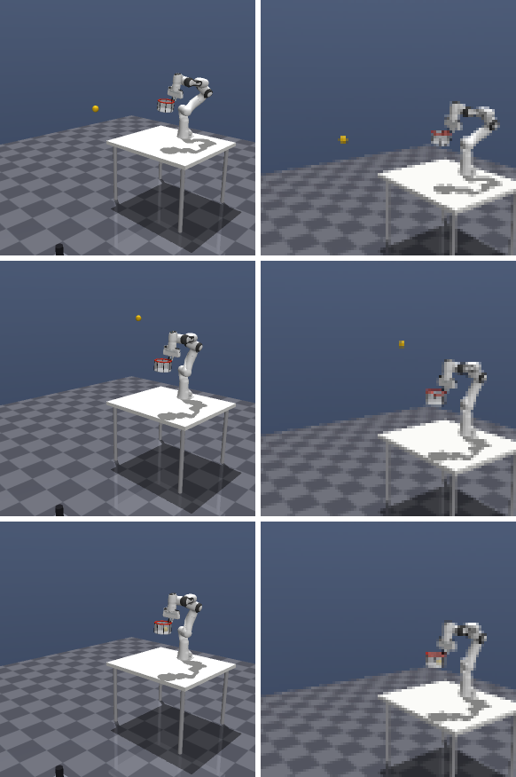

# rssm: DreamerV3 learns to catch a thrown ball

A Franka Panda with a net on its gripper has to catch a ball fired from a launcher across the room. The agent is
[DreamerV3](https://arxiv.org/abs/2301.04104) (PyTorch). It sees only a 96 x 96 camera image and its own joint
state, learns a world model of the scene, and trains its policy on rollouts imagined by that model.

The task is `BallisticCatch` from [dynamic-environments](https://github.com/maheshreddy24/dynamic-environments)
(MuJoCo), included as a submodule. The DreamerV3 code started from
[NaturalDreamer](https://github.com/InexperiencedMe/NaturalDreamer) and was reworked to match the paper.

**Status:** the full pipeline runs and is smoke-tested; the first full training run is pending.

<p align="center">
<br/>
<em>The scripted expert catching a ball, 0.25 s, 0.6 s and 0.9 s after launch. Left: third-person view.
Right: what the policy sees (96 x 96, upscaled).</em>
</p>

## Quick start

```bash
git clone --recursive https://github.com/maheshreddy24/rssm.git && cd rssm
pip install -r requirements.txt
pip install -e dynamic-environments
export MUJOCO_GL=egl                                   # headless rendering

python main.py --config configs/catching.yml           # full run: 1M env steps
```

Every config value can be overridden on the command line. A 2-minute run with a tiny model checks the whole pipeline
on a new machine:

```bash
python main.py --config configs/catching.yml --set numEnvs=2 envSteps=2000 prefillSteps=400 logInterval=400 \
    evaluationInterval=1000 numEvaluationEpisodes=2 dreamer.batchSize=4 dreamer.batchLength=32 \
    dreamer.model.hiddenSize=64 dreamer.model.recurrentSize=256 dreamer.model.latentClasses=8 dreamer.model.cnnDepth=8
```

Outputs, named after the run:

| Folder | Contents |
|---|---|
| `metrics/` | training metrics (`.csv`) every `logInterval` steps, evaluation metrics (`_evaluation.csv`) |
| `plots/` | interactive plots of both (`.html`) |
| `videos/` | an evaluation episode (third-person view next to the policy's view) and an open-loop world-model prediction |
| `checkpoints/` | agent checkpoints at every evaluation; `resume: True` restores the agent (not the replay buffer) |

## The task

| | |
|---|---|
| Observation | 96 x 96 RGB from a fixed camera, plus a 22-D arm state: gripper position (3), orientation (4), width (1), joint angles (7), joint velocities (7) |
| Action | `[dx, dy, dz]` in [-1, 1]: moves the net up to 4 cm per step (1.2 m/s); the net always faces up |
| Control | 30 Hz, no action repeat |
| Episode | ~43 steps. The ball sits in the launcher for 0.25-0.6 s, flies ~1 s, and the episode ends when it is caught or hits the table or floor |
| Randomized | launcher position, catch point, flight time, launch time, lighting (camera jitter optional) |
| Success | the ball is inside the net when it stops falling (it must not bounce out) |

**Camera.** BallisticCatch's own camera shows the ball as ~2 pixels at 96 x 96. The `wide` camera
(`envs/catching.py`) is framed to fit the highest arcs (2.3 m) and shows it as ~4 pixels, on 91% of flight frames.
`imageSize: 128` gives ~8 pixels at higher compute cost; `python tools/camera_check.py` compares the options.

## Reward

The reward uses the simulator's ball position and velocity; the policy never sees them. There is no air drag, so the
ball's future path is exact until it touches something.

```
r = 1.0  * [ball caught]                                 terminal
  + 1.0  * (d_previous - d_now)                          progress, from launch on
  + 0.02 * exp(-50 * d_now^2)                            precision, from launch on
  - 0.0  * ||a||^2                                       optional action penalty

d = distance from the net centre to the part of the ball's future path where it is falling
```

* **Progress** pays the net for getting closer to where the ball will be, at any distance. It adds up to
  `d_at_launch - d_at_end` over an episode, so moving back and forth earns nothing, and missing (the path falling
  past the net) makes it negative.
* **Precision** pays for staying on the path once there (~0.7 at the net rim, 8.5 cm off).
* **Only the falling part counts** because the net opens upwards; under the rising part the ball would hit it from
  below. Measuring to the path rather than to the ball keeps the arm from chasing the ball towards the launcher.
* The catch bonus is the largest term; all shaping terms point towards it. The precision term and the
  progress/precision pairing follow [Catch It!](https://arxiv.org/abs/2409.10319).

All weights are in `configs/catching.yml` under `environment.reward`. `python tools/check_reward.py` drives the
env's privileged scripted expert through the same 3-D actions the agent uses (30 episodes):

| Policy | Success | Return | Progress | Precision |
|---|---|---|---|---|
| scripted expert | 100% | 1.67 | 0.33 | 0.34 |
| random | 0% | -0.04 | -0.10 | 0.06 |
| idle | 0% | -0.05 | -0.08 | 0.03 |

The task is solvable in this action space, and random behaviour never catches the ball. That is why the sparse
catch reward alone would not be enough.

## Agent

DreamerV3 as in the April 2024 version of the paper (arXiv 2301.04104v2), with its Table 4 hyperparameters:

* **World model:** block GRU with 8 blocks, RMSNorm + SiLU, 32 categorical latents with 1% unimix, a CNN for the
  image and an MLP for symlog(state), symexp twohot reward head (255 bins), continue head. KL balancing (1.0 / 0.1)
  with 1 free nat.
* **Actor-critic:** imagination horizon 15, discount 0.997, lambda 0.95. The actor uses REINFORCE with percentile
  return normalization and entropy 3e-4. The twohot critic is regularized towards a slow EMA copy and also trained on
  replayed returns (scale 0.3).
* **Training:** LaProp (lr 4e-5, eps 1e-20) with adaptive gradient clipping 0.3, batch 16 x 64, replay ratio 512,
  bfloat16 compute.
* **Model size:** default is the paper's 12M preset (16.5M parameters with the 96 x 96 decoder); the 25M and 50M
  presets are listed in the config.
* **Not implemented:** the replay buffer's online queue and stored latent states. Sequences start from a zero state,
  and episode starts inside a sequence reset it.

## Hardware

One GPU. Measured for the default config:

* **GPU memory:** ~4 GB, so an 8 GB GPU is enough. `imageSize: 128` needs ~6 GB, and the larger presets need more.
* **RAM:** ~20 GB in total by default.
  * The replay buffer takes ~28 KB per step: 14 GB at `bufferCapacity: 500000`, 7 GB at 250000 (use that on a
    16 GB machine).
  * Each env worker takes ~0.35 GB, and the training process ~3 GB.
  * The buffer fills gradually, so `main.py` prints its final size at startup and warns if it won't fit.
* **Speed:** each env process steps at ~100 steps/s. Training speed depends on the GPU and is logged as
  `gradientStepsPerSecond`. The default run is ~500k gradient steps.

## What to watch

| Metric | Meaning |
|---|---|
| `success`, `episodeReturn` | training episodes; the same in `_evaluation.csv` for 20 fixed-seed episodes with the mean action |
| `minDistance` | closest the net got to the ball's falling path in an episode (m) |
| `reward/catch`, `reward/progress`, `reward/precision` | per-episode sums of each reward term |
| `imageLoss`, `rewardLoss` | is the world model learning the scene and the reward? |
| `entropy`, `actorStd` | exploration |

In `videos/`, the `_openLoop` video shows real frames, frames the world model imagines after seeing only the first
5, and their difference. It is the quickest check that the model sees and tracks the ball.

## Code map

| File | Contents |
|---|---|
| `main.py` | parallel envs → replay buffer → gradient steps at the replay ratio → logging, evaluation, checkpoints |
| `dreamer.py` | world model training, imagination, actor and critic training, acting, open-loop prediction |
| `networks.py` | block GRU, prior and posterior, CNN + MLP encoder and decoder, twohot heads, actor |
| `distributions.py` | symlog, symexp twohot, unimix categoricals, bounded normal actions |
| `optim.py` | LaProp with adaptive gradient clipping |
| `buffer.py` | per-env ring buffer with uint8 images and episode-start flags |
| `envs/` | `catching.py` (task wrapper, cameras), `rewards.py`, `parallel.py` (env processes), `gym_pixels.py` (CarRacing) |
| `tools/` | `camera_check.py` (ball pixels per camera and size), `check_reward.py` (expert vs random vs idle) |
| `tests/` | unit checks: `python tests/test_core.py` |
| `configs/` | `catching.yml` (this experiment), `car-racing-v3.yml` (same agent on CarRacing-v3, needs `gymnasium[box2d]`; untested since the rework) |

## Acknowledgements

* [NaturalDreamer](https://github.com/InexperiencedMe/NaturalDreamer) by InexperiencedMe, the clean DreamerV3 this
  code started from. Its [tutorial](https://www.youtube.com/watch?v=viXppDhx4R0) explains the architecture.
* [DreamerV3](https://arxiv.org/abs/2301.04104) (Hafner et al.) for the algorithm and hyperparameters.
* [Catch It!](https://arxiv.org/abs/2409.10319) (Zhang et al.) for the reward design.
* [dynamic-environments](https://github.com/maheshreddy24/dynamic-environments), which reproduces the scenarios of
  *Intercepting the Future* (CoRL 2026), for the catching task.
